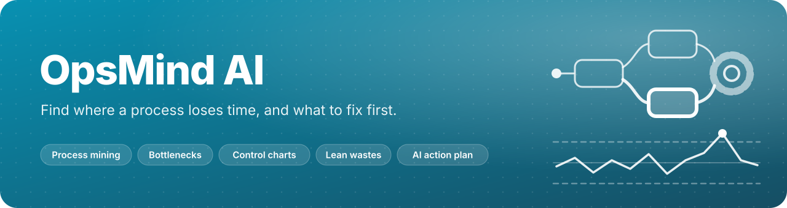
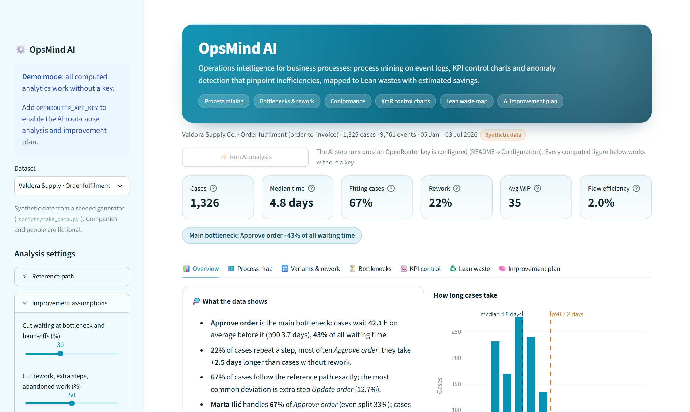
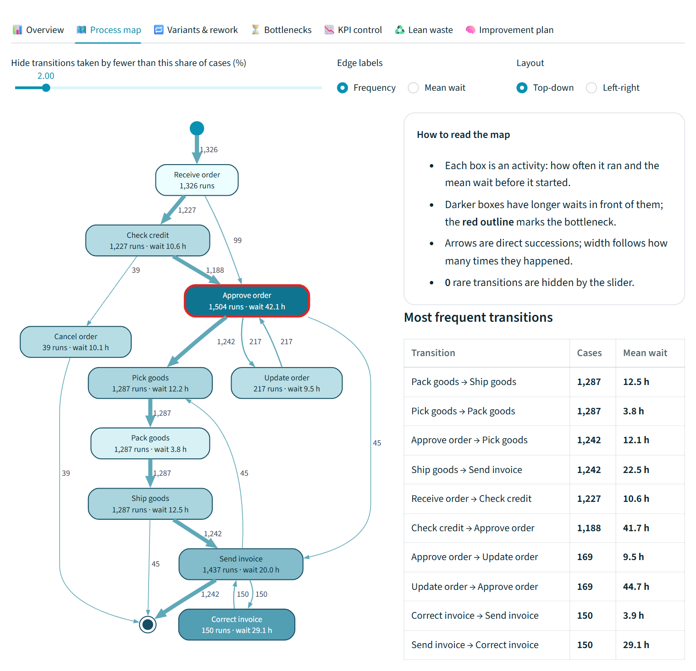
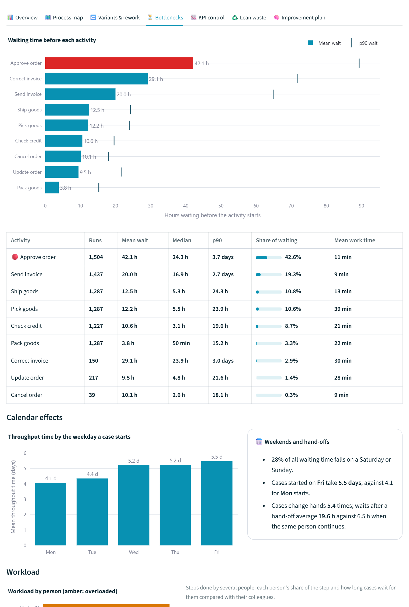
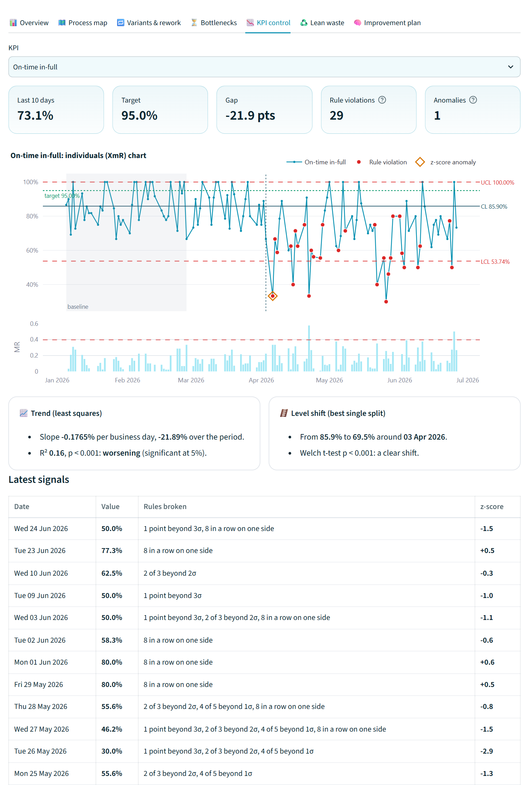
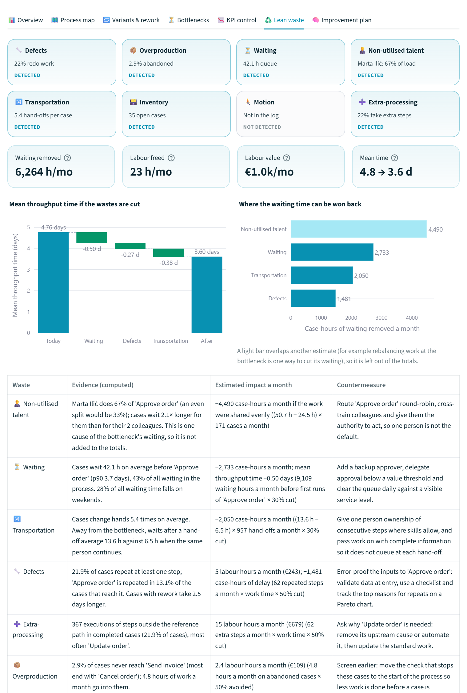
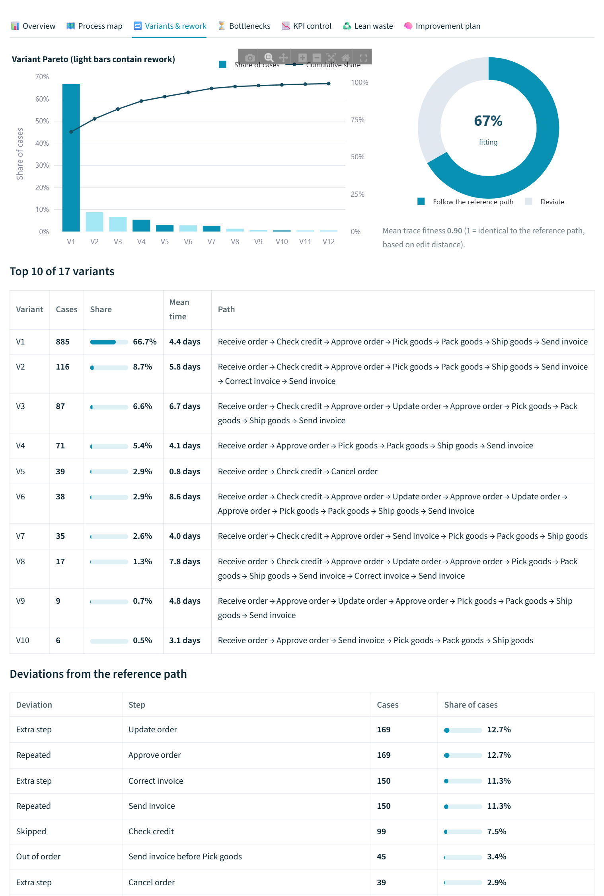
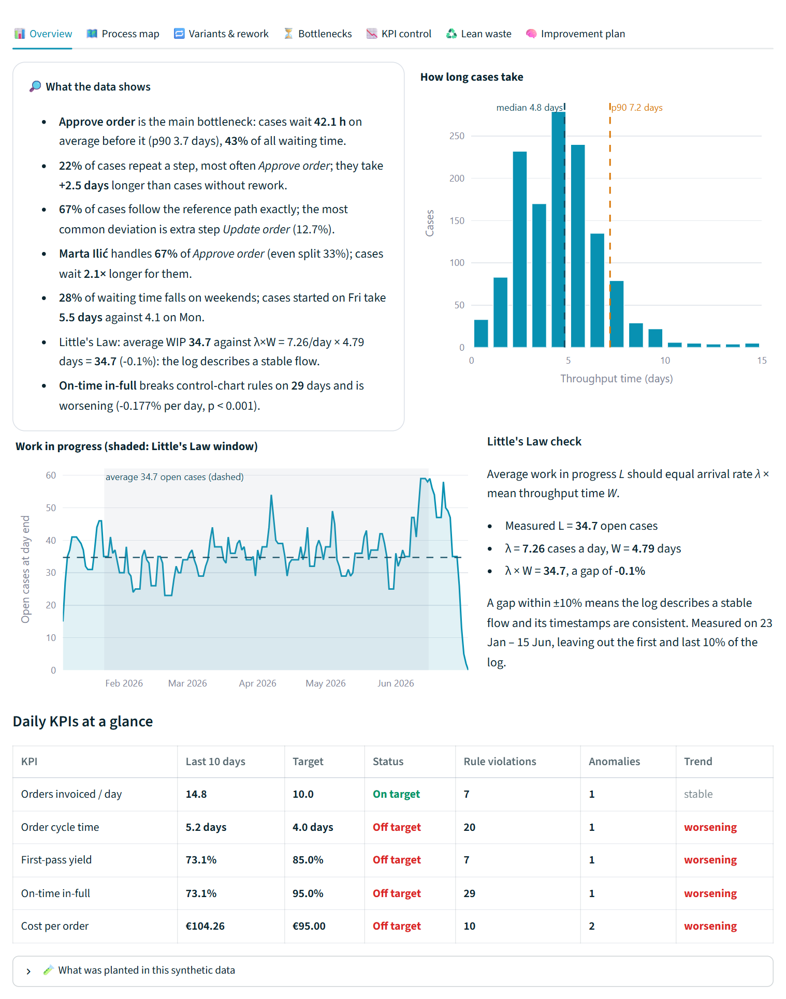
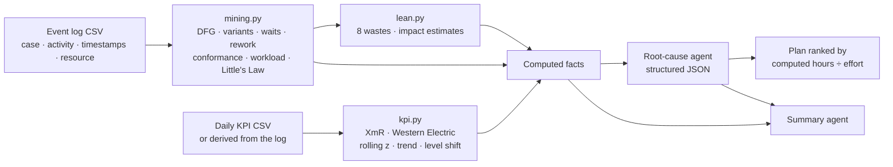

<p align="center">
  
</p>

<p align="center">
  <a href="https://github.com/iamsammy-ak/opsmind-ai/actions/workflows/ci.yml"></a>
  
  
  
  <a href="LICENSE"></a>
</p>

**OpsMind AI** is an operations analytics app for business processes. Give it an event log (one row per executed
step) and a daily KPI series, and it shows where cases wait, which steps get redone, who is overloaded, which KPIs
have drifted out of statistical control, and what each problem costs. The findings are mapped to the eight Lean
wastes with an estimate of the hours a month a fix would save.

**Every number is computed in Python**: process mining, control charts, significance tests and impact estimates. An
optional AI step then reads those computed facts and proposes root-cause hypotheses (each with a test to confirm it),
a prioritised improvement plan and an executive summary. The AI step needs a free
[OpenRouter](https://openrouter.ai/keys) key; everything else works without one.



## Features

| | |
|---|---|
| 🗺️ **Process map** | Directly-follows graph rendered with Graphviz: frequencies or mean waits on the edges, boxes shaded by the queue in front of them, the bottleneck outlined, a slider to hide rare paths |
| 🔁 **Variants and rework** | Variant Pareto with throughput times, repeated steps per activity and what rework adds to throughput time |
| ✅ **Conformance** | Share of cases that follow a reference path you define, edit-distance trace fitness, and the most common skipped, extra, repeated and out-of-order steps |
| ⏳ **Bottlenecks** | Mean, median and p90 waiting time before each activity, weekday and weekend effects, hand-off delays and an overload check per person |
| ⚖️ **Little's Law check** | Measured work in progress against arrival rate × throughput time, as a consistency check on the log |
| 📉 **KPI control** | Individuals (XmR) charts, Western Electric rules, rolling z-score anomalies, trend regression with a significance test, level-shift detection and target variance |
| ♻️ **Lean waste map** | Rule-based mapping to the eight wastes with evidence, adjustable impact estimates and a standard countermeasure for each |
| 🧠 **AI improvement plan** | Root-cause hypotheses with tests to confirm them, an action plan ranked by computed hours at stake ÷ effort, and an executive summary (needs an OpenRouter key) |
| 📝 **Report** | Downloadable Markdown report with every computed table, plus the AI sections when present |

## Screenshots

All screenshots use the synthetic sample data and show computed analysis only.

<table>
  <tr>
    <td width="50%"></td>
    <td width="50%"></td>
  </tr>
  <tr>
    <td align="center"><b>Process map</b>: directly-follows graph with the bottleneck outlined</td>
    <td align="center"><b>Bottlenecks</b>: waiting time before each activity</td>
  </tr>
  <tr>
    <td width="50%"></td>
    <td width="50%"></td>
  </tr>
  <tr>
    <td align="center"><b>KPI control</b>: XmR chart, rule violations, trend and level shift</td>
    <td align="center"><b>Lean waste</b>: eight wastes with impact estimates</td>
  </tr>
  <tr>
    <td width="50%"></td>
    <td width="50%"></td>
  </tr>
  <tr>
    <td align="center"><b>Variants and rework</b>: Pareto, conformance and deviations</td>
    <td align="center"><b>Overview</b>: computed findings and the Little's Law check</td>
  </tr>
</table>

## How it works



1. **Event log** (`opsmind/eventlog.py`) is validated and typed. Common header variants, including XES names such as
   `case:concept:name`, are recognised; unusable rows are counted and skipped.
2. **Process mining** (`opsmind/mining.py`) computes the directly-follows graph, variants, waits, rework,
   conformance, workload, calendar effects and the Little's Law check with pandas and numpy.
3. **KPI analytics** (`opsmind/kpi.py`) builds control charts and runs the statistical tests on each daily series.
   Without a KPI file, throughput, cycle time and first-pass yield are derived from the log.
4. **Lean mapping** (`opsmind/lean.py`) turns the findings into the eight wastes with transparent formulas.
5. **AI agents** (`opsmind/agents.py`) receive the computed facts only, never the raw log. The plan they return is
   ranked in Python: computed monthly hours at stake for the action's waste ÷ the effort the model assigned.

### Methods

| Method | How it is computed |
|---|---|
| Waiting time before a step | Its start − completion of the previous step in the same case (0 for overlapping work) |
| Throughput time | Last completion − first start of a case |
| Flow efficiency | Σ processing time ÷ Σ throughput time |
| Bottleneck | The activity with the most total waiting time in front of it |
| Rework rate | Cases in which a step runs more than once ÷ cases that contain the step |
| Trace fitness | 1 − edit distance to the reference path ÷ length of the longer sequence |
| Overloaded person | ≥ 1.5× an even share of a step **and** cases wait ≥ 1.25× longer for them than for colleagues |
| Little's Law | Time-averaged open cases *L* against arrival rate *λ* × mean throughput time *W*, on the middle 80% of the log |
| XmR limits | Centre = baseline mean; limits = centre ± 2.66 × mean moving range (σ ≈ MR̄ ÷ 1.128); MR limit = 3.267 × MR̄ |
| Western Electric rules | 1 point beyond 3σ; 2 of 3 beyond 2σ; 4 of 5 beyond 1σ; 8 in a row on one side of the centre |
| Rolling z-score | (x − mean of the previous *w* days) ÷ their standard deviation; anomaly when \|z\| ≥ threshold |
| Trend | Least squares on the business-day index with a two-sided t-test on the slope |
| Level shift | The single split that minimises within-segment squared error, with a Welch t-test; called clear only at p < 0.001 because the split was chosen to fit |

### Lean waste mapping

| Waste | Signal in the log | Monthly impact estimate |
|---|---|---|
| ⏳ Waiting | Queue before the bottleneck | Waiting hours before its first runs × the waiting cut |
| 🔧 Defects | Steps that run more than once | Work time of the repeats × the rework cut × labour cost |
| ➕ Extra-processing | Steps outside the reference path in completed cases | Their work time × the rework cut × labour cost |
| 📦 Overproduction | Cases that never reach the last reference step | Work spent on them × the rework cut × labour cost |
| 🧑‍💼 Non-utilised talent | One person carries most of a shared step | Extra waiting for that person if the work were shared evenly |
| 🔀 Transportation | Hand-offs between people | Extra wait after a hand-off, away from the bottleneck, × the waiting cut |
| 🗃️ Inventory | Work in progress | Open cases after the improvements, from Little's Law |
| 🚶 Motion | Not visible in an event log | Flagged as a gemba-walk question |

The waiting cut, rework cut and labour cost are sidebar sliders. Estimates that overlap (for example rebalancing an
approver who works at the bottleneck) are shown but left out of the totals.

## Synthetic sample data

The two samples are **synthetic**. `scripts/make_data.py` simulates them case by case with a seeded random generator,
a Monday-to-Friday 08:00-17:00 calendar and lognormal waiting and work times. The companies and people are fictional.

| Sample | Process | Cases | Planted realities |
|---|---|---:|---|
| Valdora Supply Co. | Order fulfilment (order-to-invoice) | 1,326 | Approval bottleneck with one overloaded manager, a reorganisation that shifts cycle time, rejected orders and invoice corrections, skipped credit checks, early pro-forma invoices, cancellations, a carrier strike, a supplier shortage and two one-day cost spikes |
| Brenmoor Foods Ltd | Procure-to-pay invoice handling | 1,247 | Budget holders who approve in fixed sessions and then move to weekly sessions, an overloaded discrepancy specialist, failed three-way matches, non-PO invoices that skip matching, invoices paid without approval, duplicates and a supplier delivery dip |

The full list of planted realities is shown in the app ("What was planted in this synthetic data") so you can check
what the analysis finds. On the Valdora sample it recovers the planted bottleneck (*Approve order*, 43% of all waiting
time), the overloaded approver and the cycle-time shift after the reorganisation; the tests assert this for both
samples. Daily KPIs are business-day series: throughput, cycle time and first-pass yield come from the simulated log,
on-time in-full and cost per case are simulated per case.

## Built for free models

OpenRouter's free models are rate-limited, so the client in `opsmind/llm.py`:

- tries a list of models in order and **skips a busy model** instead of retrying it, saving the daily quota;
- **caches** every successful reply on disk, keyed by a hash of the request, so a repeat run costs nothing;
- validates JSON against the schema and **repairs once** when a reply is malformed or cut off;
- can serve **saved analyses** from `demo/analyses/<fingerprint>.json`, generated with `scripts/build_demo.py`. A
  fingerprint covers the data and every setting, so a saved analysis is only shown for the exact combination it was
  written for.

The schemas in `opsmind/schemas.py` absorb common free-model quirks (`"High effort"`, `"waiting / queues"`, objects
where strings were expected) instead of rejecting the reply.

## Quick start

```bash
git clone https://github.com/iamsammy-ak/opsmind-ai.git
cd opsmind-ai
python -m venv .venv
source .venv/bin/activate        # Windows: .venv\Scripts\activate
pip install -r requirements.txt
streamlit run app.py
```

The app starts in demo mode: all computed analysis works on the samples and on your own CSV files.

### Configuration

The AI step needs a free key from [openrouter.ai/keys](https://openrouter.ai/keys). Copy `.env.example` to `.env`:

| Variable | Purpose |
|---|---|
| `OPENROUTER_API_KEY` | Enables the AI root-cause analysis, improvement plan and summary |
| `OPENROUTER_MODELS` | Optional comma-separated model list, tried in order |

Then click **✨ Run AI analysis**. Two model calls are made per analysis; results are cached.

### Use your own data

Pick **Upload your own CSV** in the sidebar.

| File | Columns |
|---|---|
| Event log (required) | `case_id`, `activity`, `timestamp` (completion time); optional `resource` and `start_timestamp` |
| Daily KPIs (optional) | `date` plus one numeric column per KPI. Known names (`throughput`, `cycle_time_days`, `first_pass_yield`, `otif`, `cost_per_order`) get labels and directions |

Without `start_timestamp`, waiting time is the time between completions and includes the work itself. Without
`resource`, the workload and hand-off analysis is skipped. The default reference path is the most frequent variant;
change it in the sidebar.

### Deploy on Streamlit Community Cloud

1. Fork this repository.
2. At [share.streamlit.io](https://share.streamlit.io), create an app pointing at `app.py`.
3. Optionally, under **Settings → Secrets**, add `OPENROUTER_API_KEY = "your-key"` to enable the AI step.

## Project structure

```
opsmind-ai/
├── app.py                    Streamlit interface
├── opsmind/
│   ├── eventlog.py           CSV loading, header mapping, validation
│   ├── mining.py             DFG, variants, waits, rework, conformance, workload, Little's Law
│   ├── kpi.py                XmR charts, Western Electric rules, z-scores, trend, level shift
│   ├── lean.py               eight-waste mapping and impact estimates
│   ├── processmap.py         Graphviz DOT rendering of the process map
│   ├── agents.py             root-cause and summary prompts
│   ├── llm.py                OpenRouter client: fallback, cache, JSON repair
│   ├── schemas.py            Pydantic models with lenient validators
│   ├── pipeline.py           compute, fingerprints, AI facts, plan ranking
│   ├── report.py             Markdown report export
│   ├── charts.py · ui.py     Plotly figures and styling
│   └── demo.py               sample datasets and saved analyses
├── demo/                     samples.json, synthetic CSVs, saved AI analyses
├── scripts/
│   ├── make_data.py          seeded generator for the synthetic samples
│   └── build_demo.py         generates saved AI analyses (needs a key)
└── tests/                    unit tests plus a headless run of the whole UI
```

## Testing

```bash
pip install pytest ruff
ruff check . && pytest
```

The suite checks the mining formulas on hand-computed logs (waits, throughput times, the directly-follows graph,
rework, edit-distance fitness, weekend hours, Little's Law on a steady flow), the control-chart rules one by one, the
trend and level-shift tests, the Lean estimates and their scaling, JSON extraction, schema coercion and caching with a
fake model client, that the generator reproduces the committed data, that the planted realities are found, and runs
the full Streamlit app headlessly for every sample. CI runs it on every push without an API key.

## Limitations

- Conformance compares whole sequences (exact match and edit distance); it is not alignment-based token replay, so
  genuinely parallel steps show up as separate variants.
- Impact estimates are linear what-ifs, not a queueing simulation. Real queues respond non-linearly to capacity.
- XmR limits assume independent daily values. Weekday patterns, such as batched approvals, widen the limits and hide
  signals; the Brenmoor throughput chart shows this.
- The level-shift p-value is optimistic because the split point is chosen from the data.
- Timezone-aware timestamps are converted to UTC, so weekend detection follows UTC calendar days.
- The samples are synthetic and their realities were planted on purpose; real logs are messier.
- AI hypotheses can be wrong. Each comes with a test, and the app labels them as hypotheses.

## Roadmap

- [ ] XES upload and BPMN reference models
- [ ] Alignment-based conformance checking
- [ ] Discrete-event simulation of improvement scenarios
- [ ] Working-hour and holiday calendars per team
- [ ] Control limits that account for weekday patterns

## License

[MIT](LICENSE) © 2026 Abhishek Kumar
